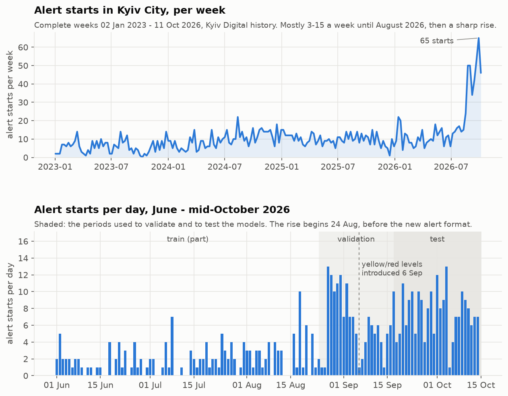
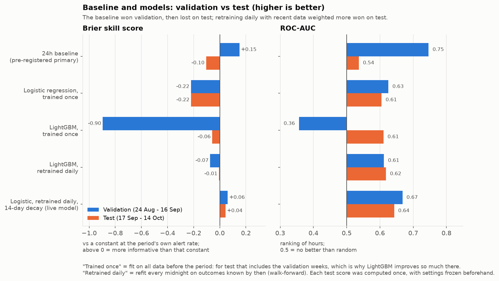

# Air-raid alert forecasting — Kyiv City

KSE Agentic AI School, Stage 2. At the top of every hour, forecast the probability that
**a new air-raid alert starts in Kyiv City within the next 3 hours**, using only information
published before that moment.

Why this target and source, and what was rejected, is in [DECISIONS.md](DECISIONS.md).

## Quick start with Docker
Needs only Docker. The image pins Python 3.12.10 and every dependency.
```bash
docker compose build
docker compose run --rm forecast                          # download fresh data, forecast for now
docker compose run --rm forecast --details                # plus model inputs and metrics
docker compose run --rm forecast --at "2026-10-10 18:00"  # replay a past moment (Kyiv time)
docker compose --profile tools run --rm tests             # full test suite (85 tests)
docker compose --profile tools run --rm evaluate          # reproduce the one-time test scores
docker compose --profile tools run --rm analyze           # bootstrap CI and breakdowns
```
The `forecast` service keeps the last good download in a named volume (`live-data`), so
`--offline` and the no-network fallback work across runs. Without network and without a cached
download, it falls back to the pinned snapshot and says so.

Checked from a fresh `git clone` with `docker compose build --no-cache --pull` (Linux aarch64):
- all 85 tests pass;
- every forecast mode works, including no network and an empty cache;
- the validation and test metrics match `reports/eval_*.csv` to within 5×10⁻¹³ (floating-point
  noise between macOS and Linux; identical at 3 decimals);
- the bootstrap interval is identical.

## Get a forecast (local Python)
Set up the environment first (see [Setup and run](#setup-and-run)), then:
```bash
.venv/bin/python scripts/predict.py                          # download fresh data, forecast for now
.venv/bin/python scripts/predict.py --offline                # no download: forecast as of the last download
.venv/bin/python scripts/predict.py --at "2026-10-10 18:00"  # replay a past moment (Kyiv time)
.venv/bin/python scripts/predict.py --details                # add model inputs, training data, metrics
```
The script downloads the full public history from Kyiv Digital (no token needed). By default it
prints a short message in Ukrainian:
```
Київ: прогноз повітряних тривог
Станом на 16.10.2026, 00:28

Ймовірність нової тривоги до 03:28: 61% (висока)

Зараз триває повітряна тривога (1 год 26 хв). Прогноз стосується наступної тривоги після відбою.

Це статистична оцінка, а не офіційне попередження.
Завжди реагуйте на сигнал повітряної тривоги.
```
The word in brackets is a presentation choice (below 30% низька, below 60% помірна, otherwise
висока), not something that was evaluated. `--details` appends the technical summary in English:
features, the 24h baseline for comparison, training data and historical metrics, plus technical
warnings.
- **Same procedure as evaluated:** the model is fit on outcomes known at the latest Kyiv midnight
  (the walk-forward protocol); only the features use events up to the forecast minute. A test
  checks that on-the-hour live forecasts equal the walk-forward predictions.
- **Cache:** a download is fully parsed before it replaces `data/live/history_cache.json`
  (git-ignored; one file with response, retrieval time and sha256). A bad download keeps the last
  good copy; an unusable cache falls back to the pinned snapshot, with a warning.
- **Stale data is not presented as "now":** without a fresh download the forecast is issued as
  of the retrieval time, because the alert status after that is unknown.

## Data
`data/raw/kyiv_digital/history_2026-10-15.json` — snapshot of the official
[Kyiv Digital air-alert history API](https://kyiv.digital/open-api/air-alert/history), with start (`state=1`) and end
(`state=0`) events from Feb 2022 to 15 Oct 2026. Timestamps are Kyiv local time without an
offset; they are converted to UTC with DST handling. The loader checks the file's sha256.

## Setup and run
Without Docker. Requires **Python 3.12 or later** (the pinned numpy 2.5.4 does not support 3.11; results were
produced with 3.12.10). On macOS LightGBM also needs the OpenMP runtime: `brew install libomp`.
```bash
python3.12 -m venv .venv && .venv/bin/pip install -r requirements.txt
.venv/bin/python -m pytest              # data, labeling and leakage tests
.venv/bin/python scripts/run_eval.py   # baselines + models on the validation period
```

## Layout
```
src/air_alerts/
  config.py     snapshot path + hash, time zone, horizon, split dates
  data.py       load events, Kyiv -> UTC, build alert episodes
  labels.py     hourly forecast grid, 3h target, train/val/test split with purging
  features.py   features computed only from events at or before t
  baselines.py  reference forecasters
  models.py     logistic regression, LightGBM, sklearn gradient boosting
  evaluate.py   Brier / log loss / ROC-AUC / PR-AUC, all hours and calm hours
  walkforward.py  daily refit on labels observed so far
  fetch.py      download, validated single-file cache, fallback to the pinned snapshot
  predict.py    forecast at any moment with the final model (daily midnight refit)
scripts/predict.py
scripts/check_minute_offsets.py   off-the-hour forecasts vs on-the-hour, test period
scripts/analyze_test.py           bootstrap CI and breakdowns for the test result
scripts/make_charts.py            README charts -> reports/figures/
Dockerfile, docker-compose.yml    container image and services (forecast; tests/evaluate/analyze)
scripts/run_eval.py
tests/          data, label and leakage tests
```

## Result (test, 17 Sep – 14 Oct 2026, scored once)
Best: **walk-forward logistic regression with 14-day time-decay weights**: Brier skill +0.04 vs the period's base rate, log loss 0.587, ROC-AUC 0.64. It beats the 24h recent-rate baseline (Brier skill −0.10) in all 4 weeks; day-block bootstrap 95% CI for the Brier gain [+0.016, +0.047], which covers only these 28 days.

**The pre-registered primary was the baseline** (best on validation), and it lost on test. The logistic model was the best learned comparator. `scripts/predict.py` uses it, a choice made after the test, so that choice has no untouched evaluation. The full story is in [DECISIONS.md](DECISIONS.md).

```bash
.venv/bin/python scripts/run_eval.py --test   # scores the frozen final set on the test period
.venv/bin/python scripts/analyze_test.py      # bootstrap CI, weekly skill, calibration by activity
.venv/bin/python scripts/make_charts.py       # redraw the charts below from the saved reports
```

## Charts

### How alert frequency changed


From January 2023 to August 2026 Kyiv had mostly 3–15 alert starts a week (about 9 on
average; one week, from 9 October 2023, had none). From 24 August 2026 the rate of recorded
starts jumped: about 7 a day on average, ranging from 1 to 13 (24 Aug – 14 Oct). That was two
weeks *before* the yellow/red alert levels were introduced on 6 September, so the rise is not
an artifact of the new format. The weekly chart shows only complete Monday–Sunday weeks. The validation
and test periods both fall inside this high-rate period. Every model trained mostly on the calm
years had to cope with that shift.

### How the baseline and models did


| Forecaster | Brier skill, validation | Brier skill, test | ROC-AUC, validation | ROC-AUC, test |
|---|---:|---:|---:|---:|
| 24h baseline (pre-registered primary) | **+0.15** | −0.10 | **0.75** | 0.54 |
| Logistic regression, trained once | −0.22 | −0.22 | 0.63 | 0.61 |
| LightGBM, trained once | −0.90 | −0.06 | 0.36 | 0.61 |
| LightGBM, retrained daily | −0.07 | −0.01 | 0.61 | 0.62 |
| Logistic, retrained daily, 14-day decay (live model) | +0.06 | **+0.04** | 0.67 | **0.64** |

Brier skill compares each forecast with a constant equal to the period's own alert rate, which
is a hindsight reference: above 0 means more informative than knowing that rate. ROC-AUC
measures how well hours are ranked (0.5 = random). "Trained once" means fit on all data before
the period, so for test it includes the validation weeks. "Retrained daily" means refit every
midnight on the outcomes known by then.

The baseline won validation and lost on test. Learned models trained once on the calm years
failed when the alert rate jumped; LightGBM even ranked hours backwards (AUC 0.36). Retraining
daily, and weighting recent weeks more, is what worked on test.

## Status
- [x] Data loading, labeling, leakage tests, baselines
- [x] First models (logistic regression, gradient boosting) — both lose to the 24h baseline, see DECISIONS.md
- [x] Walk-forward daily retraining; baseline log-odds as a feature — helps, still below the 24h baseline
- [x] Time-decay weights (14d / 60d): logistic reaches BSS +0.06, still below the 24h baseline
- [x] One-time evaluation on the test period (plan frozen in commit 6ce1942 before scoring)
- [x] Live forecast CLI (short Ukrainian message, `--details`), validated download cache
- [x] Docker image and compose stack, verified from a clean clone
